# 👋 Hi, I'm Paul John

  

 

### 🚀 About Me

  <a href="https://github.com/PaulJohnnn">
    <!-- Typing SVG replaces static text for maximum modern aesthetic -->
    
  </a>

### 🛠️ Languages and Tools

  

 

### 📈 GitHub Stats

  
  

   
  <em>Looking for my next development adventure!</em>

