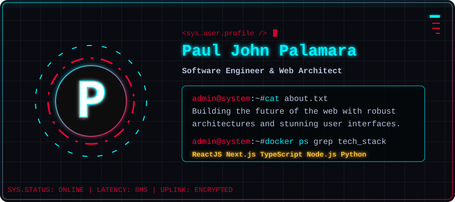

# Hi there 👋, I'm Paul John!

Welcome to my corner of GitHub. I'm a passionate developer building the future of the web.

  

## 🚀 About Me
- 🔭 I’m currently working on building awesome web experiences and robust architectures.
- 🌱 I’m currently learning deeper full-stack development and modern aesthetic designs.
- 🎨 I love creating stunning UI/UX designs and fully optimizing my code.

## ⚡ Quick Stats
_Feel free to add your own GitHub stats widgets here!_

## 🔗 Connect with me
 
 
